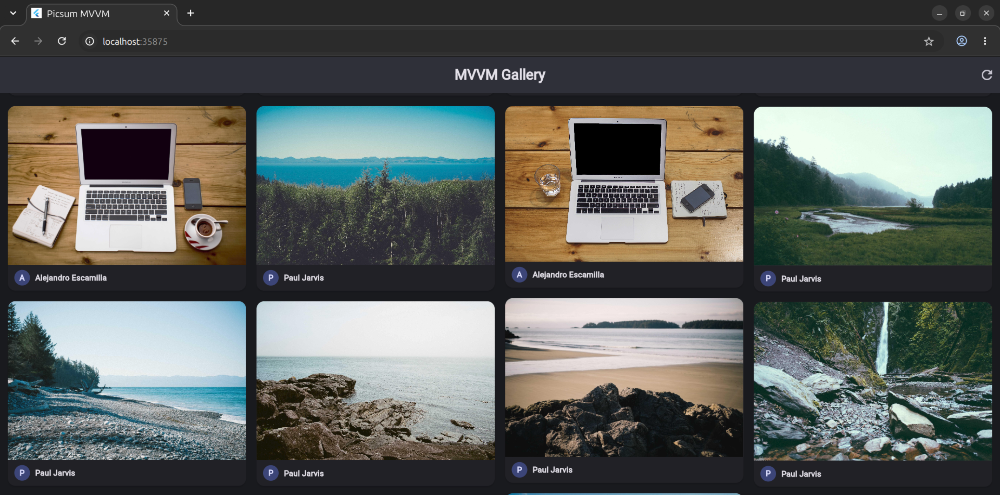
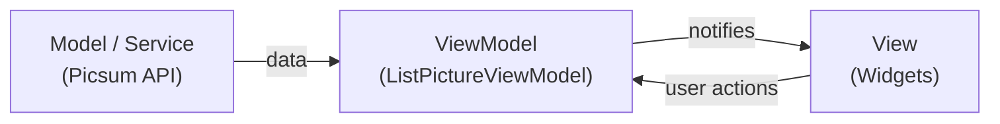

<div align="center">

# 🖼️ Products Demo

**A modern Flutter app showcasing clean MVVM architecture, Material 3 design, and a responsive masonry photo grid.**




</div>

---

## Table of Contents

- [Overview](#overview)
- [Features](#features)
- [Architecture](#architecture)
- [Project Structure](#project-structure)
- [Getting Started](#getting-started)
- [Testing & Code Quality](#testing--code-quality)
- [Tech Stack](#tech-stack)
- [Contributing](#contributing)

---

## Overview

Products Demo fetches high-resolution photos from the [Lorem Picsum API](https://picsum.photos/) and displays them in a fluid, staggered masonry grid. It is built as a practical reference for structuring a Flutter app with the **Model-View-ViewModel (MVVM)** pattern, using only Flutter's built-in state management, with no heavy frameworks required.

## Features

| | Feature | Description |
|---|---|---|
| 🏛 | **MVVM architecture** | Clear separation between UI, presentation logic, and networking. |
| ⚡ | **Reactive state** | `ChangeNotifier` + `ListenableBuilder` driven by an explicit `ViewStatus` state machine: `initial → loading → success / error`. |
| 🎨 | **Material 3** | Light and dark themes, rounded surfaces, elevated cards, and modal bottom sheets. |
| 🧱 | **Responsive masonry grid** | `MasonryGridView` adapts across phone, tablet, and desktop viewports. |
| 🔄 | **Pull to refresh** | Swipe down to load an updated feed. |
| 🔍 | **Image details** | Tap a card to see the author, dimensions, and photo ID, and copy the image link to the clipboard. |
| 🛡 | **Resilient networking** | A custom `ApiException` covers timeouts, dropped connections, and malformed responses, with in-app retry. |
| ✅ | **Tested** | Unit and widget tests for models, services, view models, and UI, using injected mock HTTP clients. |

## Architecture



| Layer | Location | Responsibility |
|---|---|---|
| **Model** | `lib/model/picsum_model.dart` | Immutable data classes with robust JSON parsing and computed properties (e.g. aspect ratio). |
| **Service** | `lib/services/services.dart` | Abstract API contract, injectable HTTP client, timeouts, and structured exceptions. |
| **ViewModel** | `lib/view_model/` | `ListPictureViewModel` manages state, API calls, caching, and transitions. `PictureViewModel` provides presentation-ready values for each card. |
| **View** | `lib/view/home.dart` | Declarative widgets that react to ViewModel updates, with no direct network logic. |

## Project Structure

```text
lib/
├── main.dart                           # Entry point & Material 3 theme setup
├── model/
│   └── picsum_model.dart               # Data model & serialization
├── services/
│   └── services.dart                   # API contract, client injection, exceptions
├── view/
│   └── home.dart                       # Home screen, masonry grid, detail sheet
└── view_model/
    ├── list_picture_viewmode.dart      # ChangeNotifier & ViewStatus management
    └── list_picture_viewmodel.dart     # Barrel export

test/
├── model/picsum_model_test.dart                    # JSON parsing & equality
├── services/services_test.dart                     # HTTP client & status codes
├── view_model/list_picture_viewmodel_test.dart     # State transitions & caching
└── widget_test.dart                                # UI & smoke tests
```

## Getting Started

### Prerequisites

- [Flutter SDK](https://docs.flutter.dev/get-started/install) `>= 3.1.5`
- Dart SDK `>= 3.1.5 < 4.0.0`

### Setup

```bash
# 1. Clone the repository
git clone https://github.com/malekaltaf/MVVM_Flutter.git
cd MVVM_Flutter

# 2. Install dependencies
flutter pub get

# 3. Run the app
flutter run
```

> 💡 Run `flutter doctor` first if you're setting up Flutter for the first time.

## Testing & Code Quality

```bash
# Static analysis
flutter analyze

# Run all unit and widget tests
flutter test

# Optional: with coverage
flutter test --coverage
```

## Tech Stack

| Package | Purpose |
|---|---|
| [`flutter_staggered_grid_view`](https://pub.dev/packages/flutter_staggered_grid_view) | Staggered masonry grid layout |
| [`http`](https://pub.dev/packages/http) | Composable HTTP client |
| [`transparent_image`](https://pub.dev/packages/transparent_image) | Placeholders for smooth image fade-ins |
| [`flutter_lints`](https://pub.dev/packages/flutter_lints) | Recommended lint rules |

## Contributing

Contributions are welcome!

1. Fork the repo and create a feature branch: `git checkout -b feature/my-change`
2. Make your changes and add tests where relevant
3. Ensure `flutter analyze` and `flutter test` pass
4. Open a pull request describing what you changed and why

---

<div align="center">

Photos provided by [Lorem Picsum](https://picsum.photos/) · Built with ❤️ using Flutter

</div>
